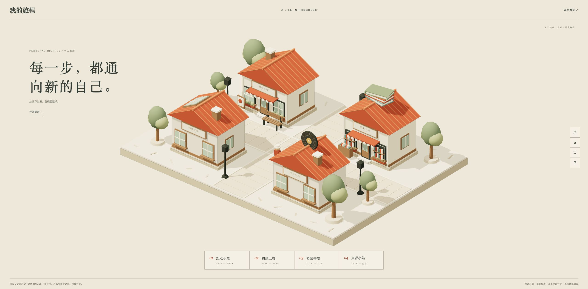
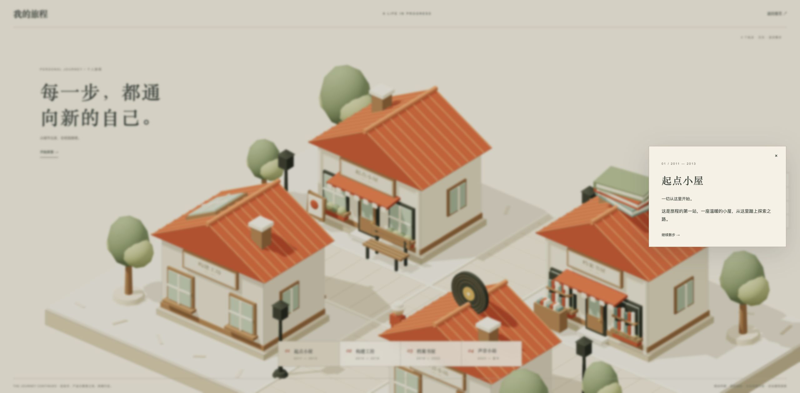
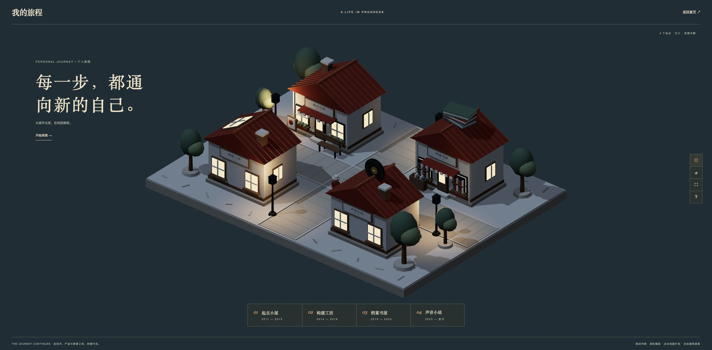
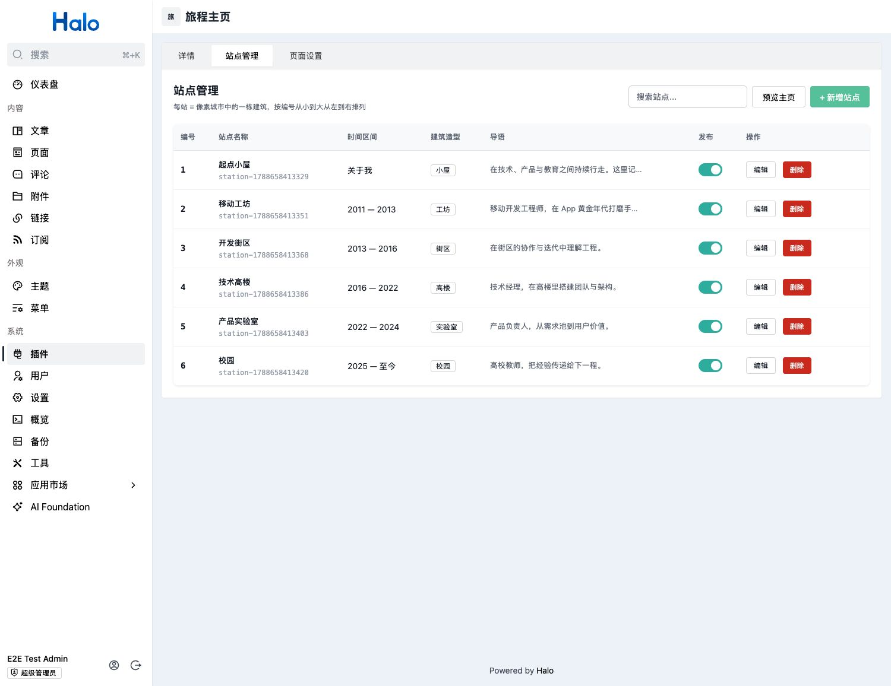
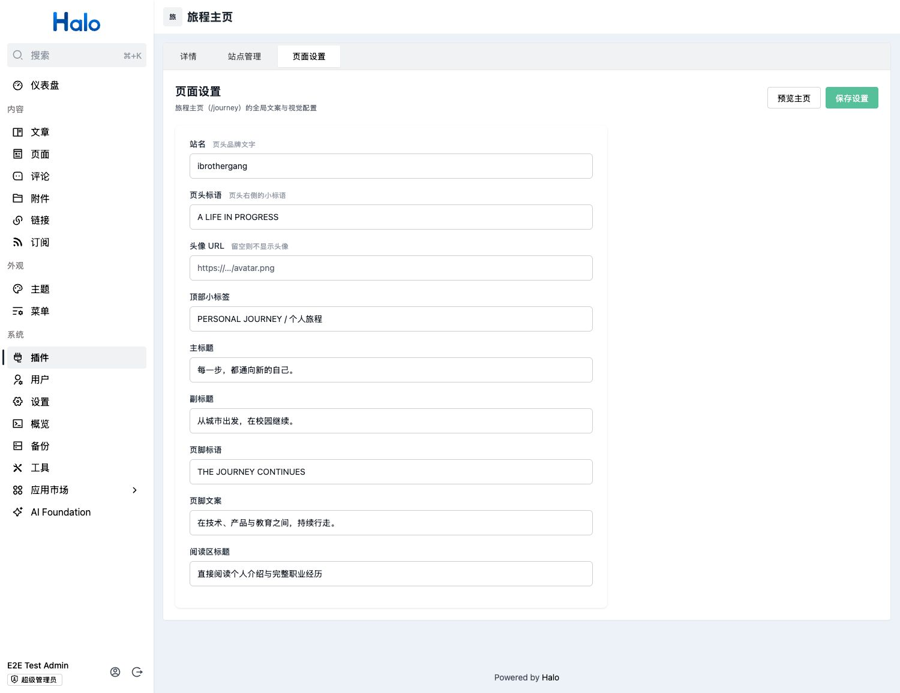

# Halo Journey Home · 旅程主页

一个游戏化的 Halo 交互式旅程主页插件：把个人履历做成一座**可探索的 3D 纸墨小街**（插件内置页面，Three.js 渲染），也可配合主题渲染**像素城市**版本。访客拖动环顾街区、操控小人行走、走进每栋建筑阅读人生章节。

> 从城市出发，在校园继续 —— 每一步，都通向新的自己。



## 特性

- **3D 纸墨小街（内置页面）**：暖纸色微缩街区，锈红屋顶、树木、街灯与柔和阴影，建筑按后台站点数据自动生成排布

- **拖动环顾与行走**：拖动旋转、滚轮缩放，点击空地自动寻路，方向键或 W A S D 手动行走

- **建筑即站点**：每栋建筑对应一个旅程站点，点击建筑或底部导航阅读章节；数量与造型完全由后台站点决定

- **日夜氛围**：一键切换日光 / 灯火夜景，窗户与街灯随夜景亮起

- **章节阅读**：点击建筑弹出章节卡片，显示站点时间区间、导语与正文

- **移动端适配**：站点导航在手机端自动变为两列网格，支持触屏拖动与行走

- **Console 管理端**：站点 CRUD、发布开关、排序，全局文案（标题 / 标语 / 页脚）可视化配置






## 环境要求

| 依赖   | 版本                                                                                                 |
| ---- | -------------------------------------------------------------------------------------------------- |
| Halo | >= 2.20.0                                                                                          |
| 主题   | 可选。[halo-theme-boommanpro](https://github.com/boommanpro/halo-theme-boommanpro)（像素城市版由主题 `journey` 模板渲染） |

> 插件提供**两种前台形态**：
> 1. **内置 3D 小街**（`/journey-3d/`）：Three.js 渲染，读取 `/journey-api/*` 数据，无需安装主题，安装插件后即可访问。
> 2. **主题像素城市**（`/journey`）：由 boommanpro 主题的 `journey` 模板渲染，与主题纸墨风格完全融合。

## 安装

### 方式一：Release 下载

1. 前往 [Releases](https://github.com/boommanpro/halo-plugin-journey-home/releases) 下载最新的 `halo-plugin-journey-home-x.y.z.jar`
2. Halo Console → 插件 → 安装 → 上传 JAR
3. 启用插件

### 方式二：在线安装

在插件安装页使用 Release 地址直接安装。

## 使用

### 0. 直接访问 3D 小街（无需主题）

安装并启用插件后，直接访问：

```
/journey-3d/
```

页面自动读取 `/journey-api/*` 数据渲染街区，站点数量与建筑造型完全由后台配置决定。

### 1. 创建旅程页面（主题像素版，可选）

1. 安装并启用 [boommanpro 主题](https://github.com/boommanpro/halo-theme-boommanpro)
2. Console → 页面 → 创建页面，slug 建议 `journey`
3. 模板选择 **「Journey 交互式旅程」**
4. 发布后访问 `/journey` 即可

### 2. 配置站点



Console → 插件 → 旅程主页 → **站点管理**：

- 新增站点：名称、时间区间（如 `2013 — 2016`）、建筑造型、导语、Markdown 正文

- 支持搜索、编辑、删除、发布开关

- 编号即街道上的排列顺序

### 3. 全局文案



Console → 插件 → 旅程主页 → **页面设置**：配置主标题、副标题、页头标语、页脚文案、阅读区标题等，保存后前台即时生效。

## 3D 小街操作

| 操作                | 功能            |
| ----------------- | ------------- |
| 拖动 / 滚轮          | 旋转环顾 / 缩放街区 |
| 点击空地             | 小人自动步行过去     |
| `←` `→` `↑` `↓` / `W` `A` `S` `D` | 手动行走 |
| 点击建筑 / 底部导航       | 打开站点章节        |
| 右侧日夜按钮 / 回转按钮     | 切换夜景 / 恢复全景  |

## 技术实现

```
halo-plugin-journey-home/
├── src/main/java/run/halo/journeyhome/
│   ├── extension/     # JourneyStation / JourneyPageConfig 自定义模型
│   ├── endpoint/      # 公开 API（/journey-api）+ 3D 页面路由（/journey-3d）+ Console 管理 API
│   └── service/       # 站点服务
├── frontend/          # 内置 3D 小街（Vite + Three.js，构建后打包进 JAR）
│   └── src/           # scene.js 场景 / main.js 页面 / data.js 数据接入 / style.css 纸墨样式
└── ui/                # Console 管理端（Vue 3 + @halo-dev/console-shared）
    └── src/views/     # 站点列表 / 站点编辑 / 页面设置
```

3D 小街由插件 `frontend/` 构建产物（`journey-3d/` 资源）随 JAR 分发，`Journey3dRouter` 通过插件类加载器返回 HTML 与静态资源，匿名权限已放行。页面通过 `createScene` 按 `layoutStations` 动态排布建筑，读取 `/journey-api/*` 数据，不依赖主题。

主题像素城市版本（像素小人、rAF 游戏循环、键盘状态机）在主题模板 `templates/journey.html` 中实现，全部使用主题 CSS 变量，自动适配深浅色。

### 公开接口

| 接口                          | 说明            |
| --------------------------- | ------------- |
| `GET /journey-api/stations` | 已发布站点列表（无需登录） |
| `GET /journey-api/config`   | 全局页面文案（无需登录）  |

## 开发

```bash
# 构建（自动安装前端依赖并打包 Console UI）
./gradlew build

# 产物
build/libs/halo-plugin-journey-home-x.y.z.jar
```

要求：JDK 21、Node 20+、pnpm 9。

## License

[MIT](https://opensource.org/licenses/MIT)
